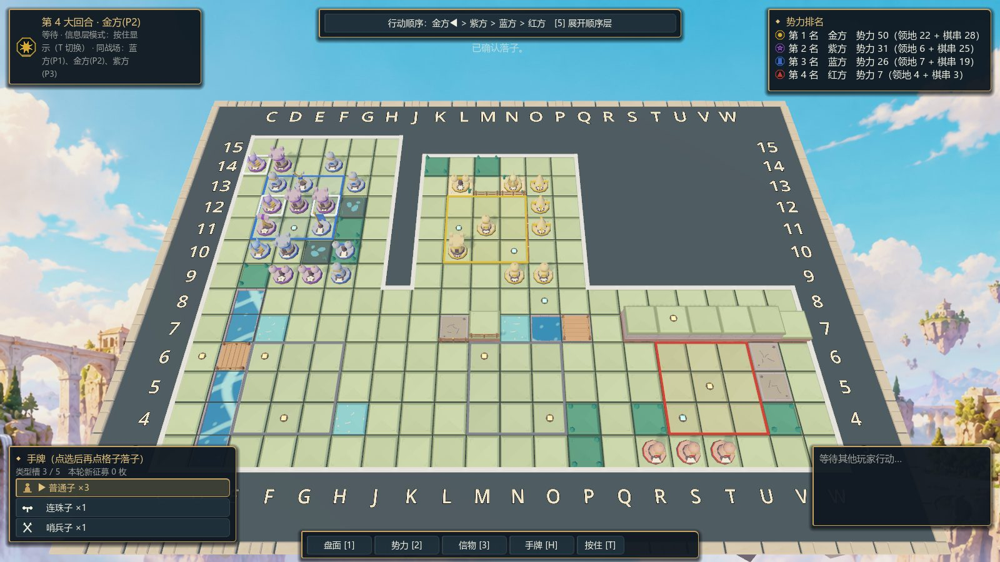

# 围杀 Siege

《围杀》是四人回合制策略构筑游戏原型。五块主题出生棋盘拼成一张开放地图：前 3 个大回合在自己的出生棋盘筑阵，第 4 大回合起全图交战。围住敌方棋串可以提子，控制地块、信物与棋串来积累势力。当前提供 1 名玩家对 3 个 AI 的单机对局。

- [下载 Windows 版与玩法介绍](https://siege.wws741.workers.dev)
- [全部 GitHub Releases](https://github.com/Skysolderone/geme_demo/releases)
- [基础版美术资源清单](art/full-art-v1/README.md)（`art-base-v1`）



## 下载与运行

当前 `v0.5.0` 提供 Windows 10 / 11 64 位版本。解压整个包后运行 `Siege.exe`；`Siege.pck` 和 `data_Siege.Godot_windows_x86_64` 必须留在同一目录。首次启动如遇 Windows SmartScreen 提示，按发布页的说明操作。这个版本没有 macOS 包；早期 macOS 包来自规则不同的开发线。

## 怎么玩

1. 在五块主题棋盘中点选一块插旗。插旗锁定后，五块棋盘全部展开。
2. 征募棋子，在左下手牌选类型，点击棋盘格暂放。右侧预演会显示整批结果；按 `Enter` 确认，或按 `P` 跳过。
3. 前 3 个大回合只能在自己的出生棋盘落子与改造；第 4 大回合起可在整张地图行动。四人整轮跳过、地图填满或只剩一人时终局。

新局使用计分 V2：同色连通棋串达到 3 / 5 / 8 / 12 枚时，阵型依次升至 1 / 2 / 3 / 4 阶。旧存档沿用计分 V1。

| 操作 | 按键 |
| --- | --- |
| 盘面 / 势力 / 信物 / 行动顺序信息层 | `1` / `2` / `3` / `4` |
| 切换盘面读法、信息层显示方式 | `Tab`、`T` |
| 手牌、收起征募面板、轮换匠人改造目标 | `H`、`V`、`E` |
| 平移、缩放、回到自己的出生棋盘 | 方向键或 `WASD`、滚轮、空格 |
| 一屏预览地图 | `M` |
| 切换跟随对手镜头 | `F` |

详细规则与现状见 [HANDOFF.md](HANDOFF.md) 和 [规格目录](openspec/specs/)。地图标识只接受 `link:<种子>`；旧的隔离棋盘图及 `board:`、`gen:` 标识已删除。

## 从源码运行

需要 .NET 8 SDK 和 Godot 4.7.2 .NET 版。图形版工程在 `src/godot/`，规则与模拟器在 `src/Siege.Core/`、`src/Siege.Sim/`。

```powershell
dotnet build src/godot/Siege.Godot.csproj
godot --path src/godot -- --map=link:1 --no-carry
dotnet test tests/Siege.Core.Tests/Siege.Core.Tests.csproj
```

在 Windows 上若 Godot 未加入 `PATH`，用安装目录中的 `Godot_*_console.exe` 代替 `godot`。自定义游戏参数放在 Godot 参数分隔符 `--` 后。`--no-carry` 会关闭带入带出档案的读写。

终端版示例：

```powershell
dotnet run --project src/Siege.Sim -- play --map link:1 --difficulty Standard --no-carry
```

## 打包与发布

Windows 上运行 `tools/export-release.ps1 -Version 0.5.0`；Bash 环境可运行 `tools/export-release.sh 0.5.0`。脚本导出到当前工作树的 `build/windows/Siege/`，并生成 `build/Siege-windows-x64-v0.5.0.zip`。`build/` 被 Git 忽略，上传 GitHub Releases 是单独的发布步骤。导出后应在 Windows 上从包内启动游戏进行验收。

`docs/` 是静态发布页，由根目录 `wrangler.jsonc` 配置。美术基础版的生成源、Godot 场景与实机截图在 [art/full-art-v1](art/full-art-v1/README.md)。
